# Logic Noise Synth — "Circuits son"

Polyphonic logic-gate synthesizer built during the **Logic Noise Workshop** (ESILV, Circuits course).
Square-wave oscillators made from a **74HC14** Schmitt-trigger hex inverter are sequenced by a **74HC595** shift register, mixed, amplified and played through a speaker/piezo.

**Team:** Pierre — *(add teammates)*

| Stage | Tool | Files |
|---|---|---|
| 1. Breadboard prototypes (step by step) | Breadboard + oscilloscope | [`media/photos`](media/photos), [`media/video`](media/video), [`media/audio`](media/audio), [`media/scope`](media/scope) |
| 2. Hand-drawn circuits | Paper | [`media/hand-drawn`](media/hand-drawn) |
| 3. Breadboard diagram + generated schematic | Tinkercad | [`media/tinkercad`](media/tinkercad) |
| 4. Soldered synth (V1) | Perfboard + soldering iron | [`media/photos`](media/photos) |
| 5. PCB version 2 | KiCad | [`kicad/`](kicad) |

---

## Table of contents

1. [How it works](#1-how-it-works)
2. [Reference circuit](#2-reference-circuit)
3. [Breadboard prototypes](#3-breadboard-prototypes)
4. [Hand-drawn circuits & oscilloscope captures](#4-hand-drawn-circuits--oscilloscope-captures)
5. [Tinkercad breadboard diagram & schematic](#5-tinkercad-breadboard-diagram--schematic)
6. [Soldered synth (V1)](#6-soldered-synth-v1)
7. [KiCad V2 — PCB with new functionality](#7-kicad-v2--pcb-with-new-functionality)
8. [Bill of materials](#8-bill-of-materials)
9. [Repository structure](#9-repository-structure)
10. [References](#10-references)

---

## 1. How it works

### 1.1 The Schmitt-trigger oscillator

An inverter outputs the opposite of its input. Feed the output back to the input through a resistor **R** and add a capacitor **C** to ground: the capacitor charges and discharges through R, and each time its voltage crosses one of the two Schmitt thresholds the output flips. The result is a square wave at the output (and a triangle-like ramp on the capacitor).

```
           R (10 kΩ pot)
     ┌────/\/\/\────┐
     │              │
 in ─┴──|>o─────────┴── out  (square wave)
     │  74HC14
     C
     │
    GND
```

Frequency (workshop rule of thumb):

$$f \approx \frac{k}{RC}, \qquad 0.2 < k < 1.0$$

Turning the potentiometer changes R, so it changes the pitch. Changing C changes the range: µF values give rhythm (a few Hz), 100 nF and below give audible tones.

### 1.2 Sequencing with the 74HC595

Two more oscillators act as a **CLOCK** and a **DATA** source:

- **CLOCK** → `SRCLK` and `RCLK`: on each tick the register shifts one position.
- **DATA** → `SER`: the bit pushed in on each tick is 1 or 0 depending on the DATA oscillator's state at that moment.

Because the two oscillators run at unrelated rates, the bit pattern moving through `QA…QH` is quasi-random and evolves constantly. Outputs of the register gate the pitch oscillators through diodes (reference circuit) or drive LEDs (our V2): this turns 3 free-running tones into a rhythmic, generative pattern.

### 1.3 Mixing and amplifying

The oscillator outputs are summed through equal resistors (passive mixer), AC-coupled through an electrolytic capacitor to remove the DC offset, then amplified (LM386 in the reference circuit) to drive a speaker.

---

## 2. Reference circuit

Final target circuit given by the workshop (correction):

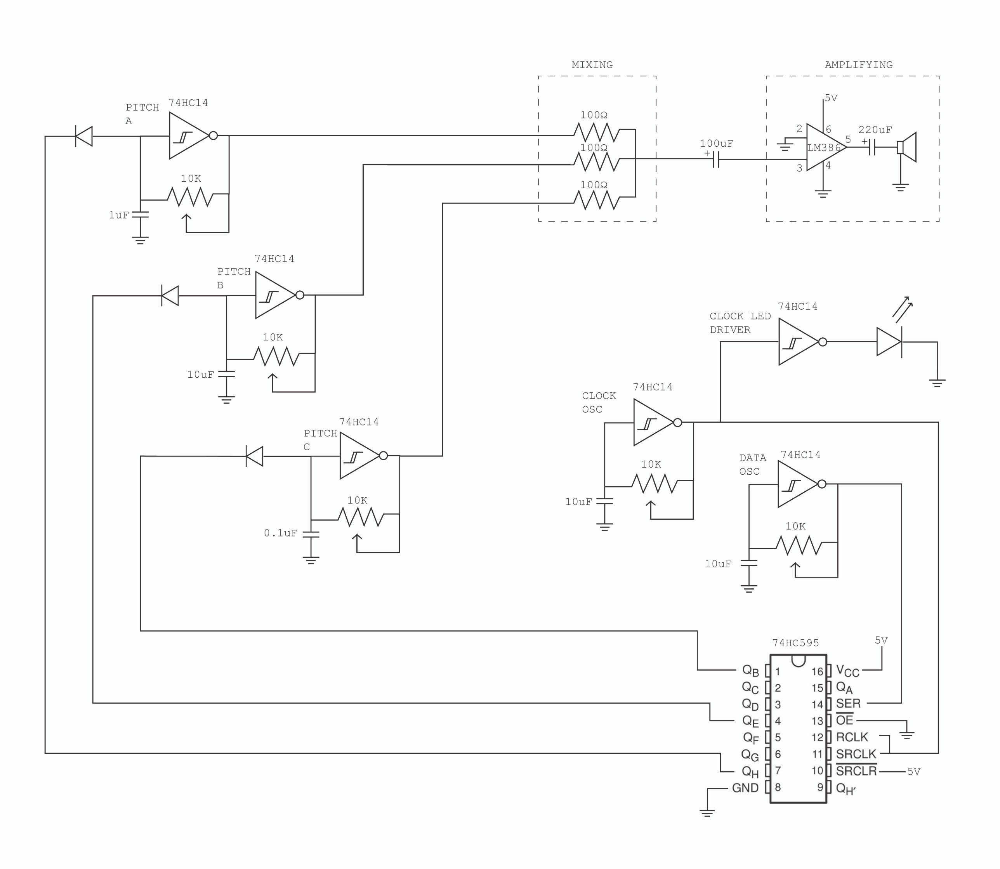

| Block | Gate | R | C | Approx. range* | Role |
|---|---|---|---|---|---|
| Pitch A | 74HC14 | 10 kΩ pot | 1 µF | 20 – 100 Hz and up | Bass tone |
| Pitch B | 74HC14 | 10 kΩ pot | 10 µF | 2 – 10 Hz and up | Slow pulse |
| Pitch C | 74HC14 | 10 kΩ pot | 0.1 µF | 200 – 1000 Hz and up | High tone |
| Clock osc | 74HC14 | 10 kΩ pot | 10 µF | 2 – 10 Hz and up | Shift-register clock + clock LED |
| Data osc | 74HC14 | 10 kΩ pot | 10 µF | 2 – 10 Hz and up | Shift-register serial data |
| Mixer | — | 3 × 100 Ω | — | — | Sums Pitch A/B/C |
| Amplifier | LM386 | — | 100 µF in / 220 µF out | — | Drives the speaker |

\* Computed with *f = k/RC*, R = 10 kΩ (pot at maximum), k between 0.2 and 1. Lowering the pot raises the frequency.

Shift-register wiring: `QB → Pitch C`, `QE → Pitch B`, `QH → Pitch A` (through diodes), `OE` to GND, `SRCLR` to 5 V.

---

## 3. Breadboard prototypes

The circuit was built incrementally, following the workshop steps:

1. Single 74HC14 oscillator blinking an LED (10 µF, 1 kΩ).
2. Potentiometer in the feedback loop → variable rate.
3. Smaller capacitor → audible tone, observed on the oscilloscope.
4. Amplifier stage → sound out of the speaker/piezo.
5. Several oscillators mixed through resistors.
6. 74HC595 shift register clocked by a CLOCK oscillator and fed by a DATA oscillator, LEDs on its outputs.

### Full prototype on two breadboards

| Bench view | Top view (running, LEDs lit) |
|---|---|
| 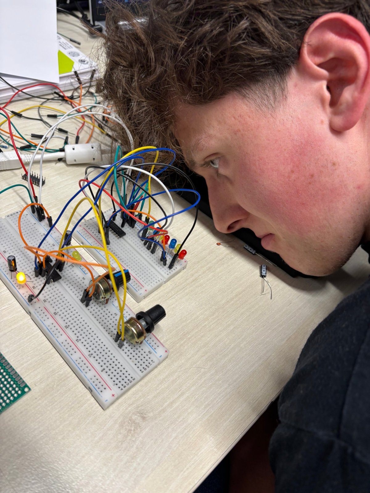 | 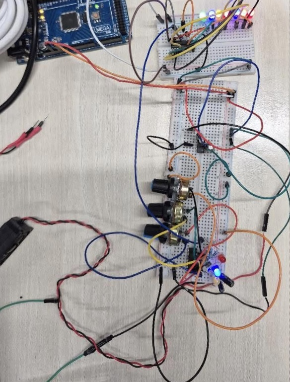 |

Left board: 74HC14 oscillators, op-amp, potentiometers and capacitors. Right board: 74HC595 shift register and its LED display. Power (5 V / GND) is taken from an Arduino board.

### Videos / GIFs

<!-- Drop the files in media/video and uncomment/adapt the lines below.
     GitHub plays .mp4 files dragged into the README editor; GIFs display inline. -->

| Circuit | Media |
|---|---|
| Single oscillator + LED | `media/video/01_oscillator_led.gif` *(to add)* |
| Pitch control with the potentiometer | `media/video/02_pitch_pot.mp4` *(to add)* |
| Shift-register sequence (LEDs) | `media/video/03_shift_register.mp4` *(to add)* |
| Full synth playing | `media/video/04_full_synth.mp4` *(to add)* |

### Audio recordings

| Recording | File |
|---|---|
| Single oscillator, pot sweep | `media/audio/01_single_osc_sweep.mp3` *(to add)* |
| Two oscillators mixed | `media/audio/02_mix.mp3` *(to add)* |
| Full sequenced synth | `media/audio/03_full_synth.mp3` *(to add)* |

---

## 4. Hand-drawn circuits & oscilloscope captures

### Hand-drawn schematics

| Drawing | File |
|---|---|
| Schmitt-trigger oscillator | `media/hand-drawn/oscillator.jpg` *(to add)* |
| Full synth | `media/hand-drawn/full_synth.jpg` *(to add)* |

### Oscilloscope screenshots

| Signal | What to observe | File |
|---|---|---|
| Oscillator output (74HC14 out) | Square wave 0 V → Vcc; period changes with the pot | `media/scope/osc_output.png` *(to add)* |
| Capacitor node (74HC14 in) | Ramp between the two Schmitt thresholds | `media/scope/osc_capacitor.png` *(to add)* |
| Mixer output | Stepped sum of several square waves | `media/scope/mix.png` *(to add)* |
| CLOCK vs 595 output | Output changes only on clock edges | `media/scope/clock_vs_q.png` *(to add)* |

Scope settings used: probe ground clip on circuit GND, ~1 V/div, ~200 ms/div for slow oscillators, µs–ms/div for audio-rate ones.

---

## 5. Tinkercad breadboard diagram & schematic

### Breadboard diagram

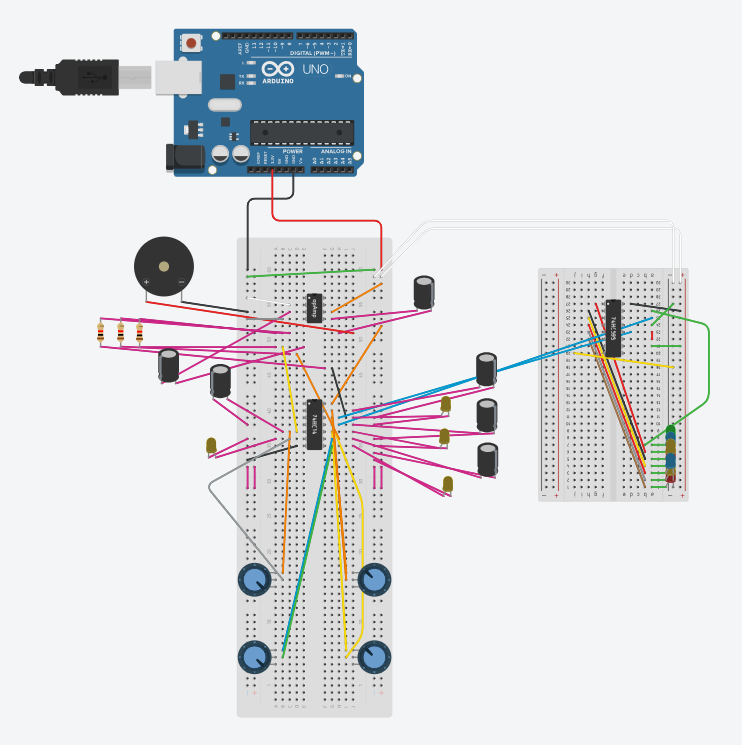

### Schematic generated by Tinkercad

| Sheet 1 | Sheet 2 |
|---|---|
| 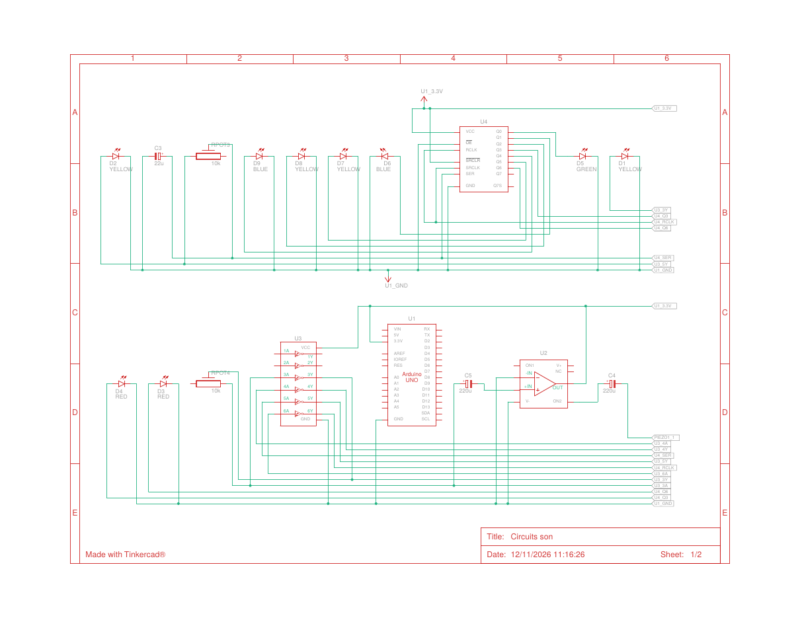 | 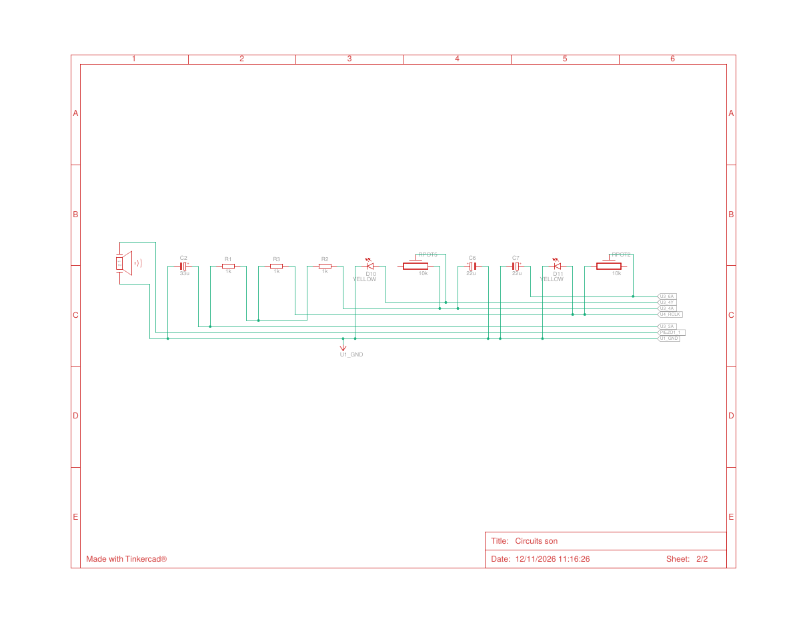 |

PDF: [`media/tinkercad/tinkercad_schematic.pdf`](media/tinkercad/tinkercad_schematic.pdf)

Differences from the reference circuit:

| Reference | Tinkercad version | Reason |
|---|---|---|
| LM386 audio amplifier | 741 op-amp (U2) | Part available in Tinkercad |
| Speaker | Piezo buzzer | Part available in Tinkercad |
| 5 V bench supply | Arduino Uno 5 V / 3.3 V / GND | Power source only, no code |
| QB/QE/QH gate the pitch oscillators | 595 outputs drive 7 LEDs | Visual feedback of the sequence |
| — | LEDs on oscillator outputs | Visual feedback of each oscillator |

---

## 6. Soldered synth (V1)

The breadboard circuit was transferred onto a 2.54 mm perfboard: 74HC14 oscillators, 74HC595 shift register with its LED row, 8-pin audio amplifier, two front-panel potentiometers and a speaker on a twisted pair. Connections are made point-to-point with wire on the solder side.

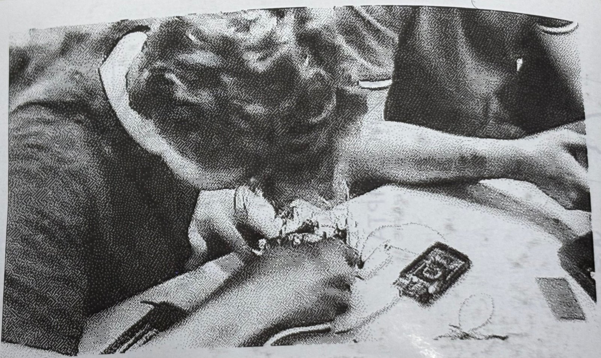

| Top (components) | Solder side | With speaker |
|---|---|---|
| 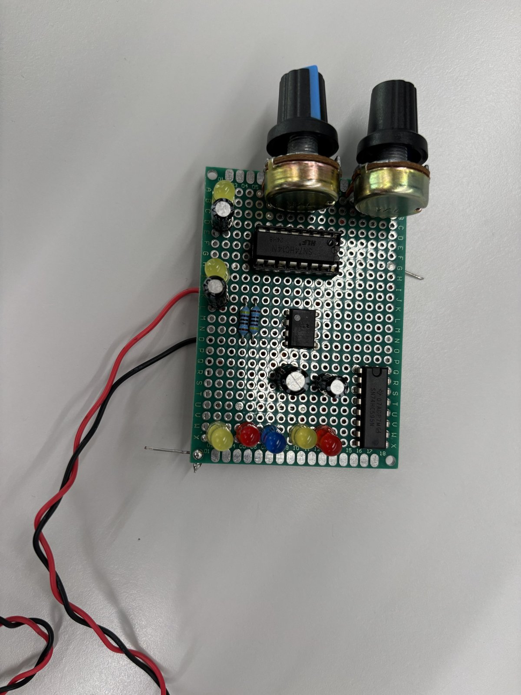 | 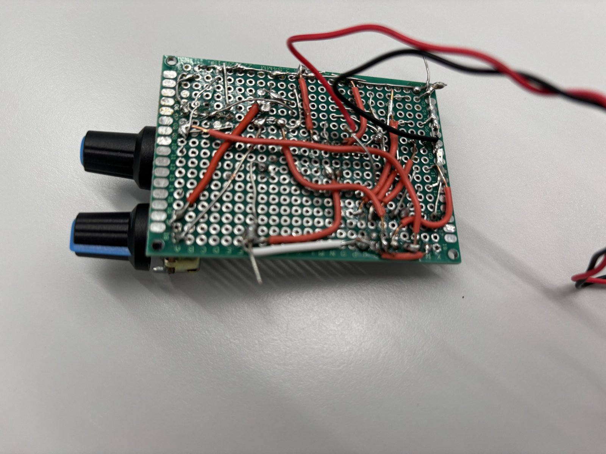 | 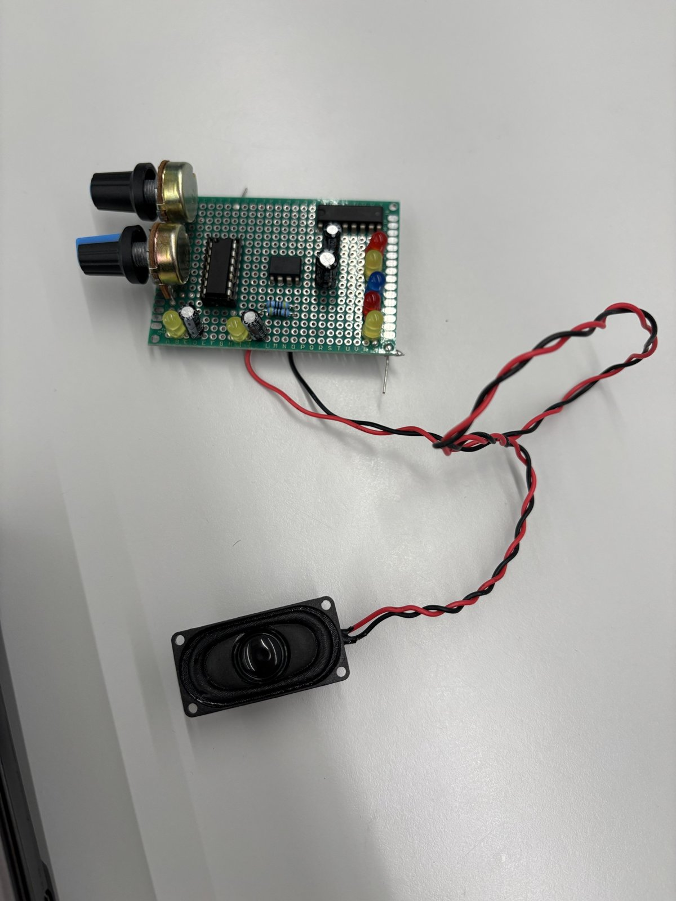 |

| Proof of functioning | File |
|---|---|
| Video with sound | `media/video/v1_soldered_working.mp4` *(to add)* |

---

## 7. KiCad V2 — PCB with new functionality

Files: [`kicad/circuits_son.kicad_sch`](kicad/circuits_son.kicad_sch), [`kicad/circuits_son.kicad_pcb`](kicad/circuits_son.kicad_pcb), project [`kicad/circuits_son.kicad_pro`](kicad/circuits_son.kicad_pro). Open the `.kicad_pro` in KiCad.

| PCB layout (KiCad) | 3D view (KiCad) |
|---|---|
| 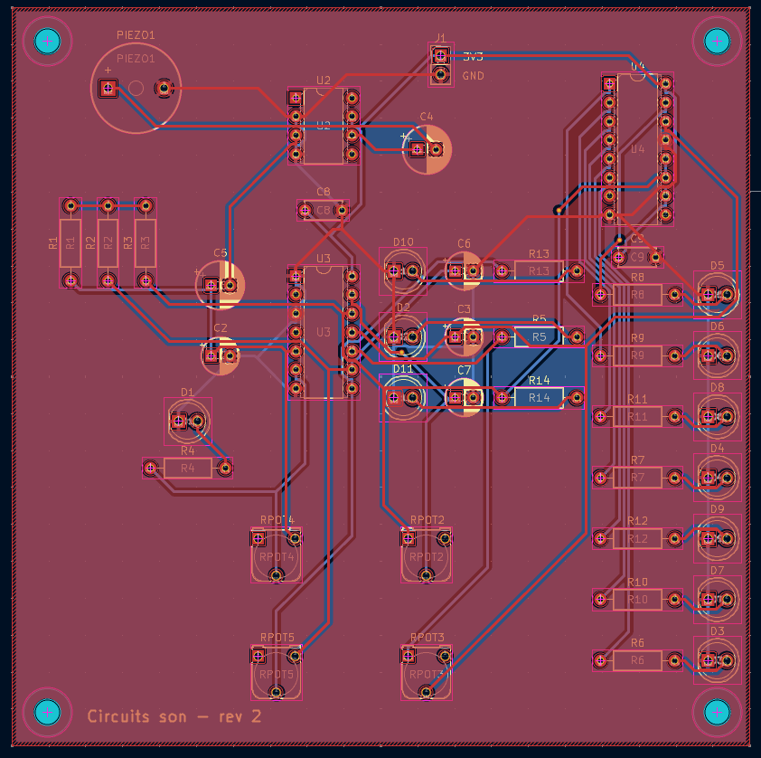 | 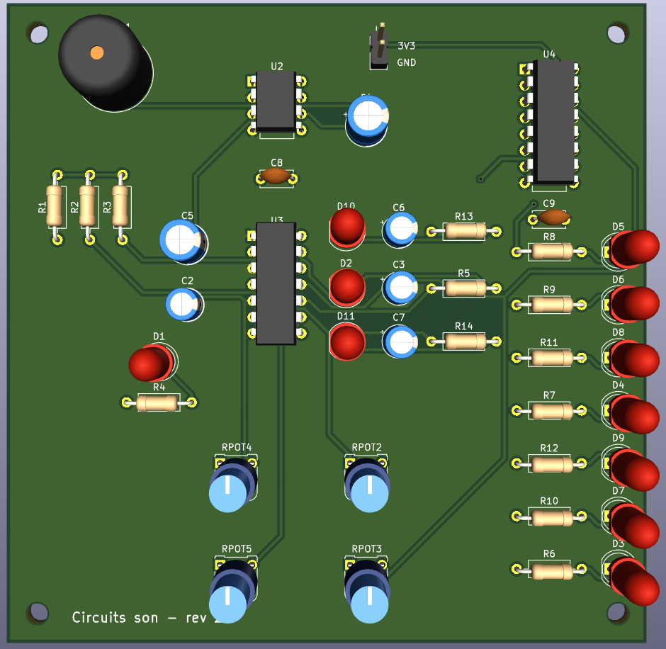 |

### Board specifications

| Parameter | Value |
|---|---|
| Size | 100 × 100 mm |
| Layers | 2 (F.Cu / B.Cu), 1.6 mm FR-4 |
| Copper pours | GND on both layers |
| Track width | 0.4 mm (Default net class), clearance 0.25 mm |
| Components | All through-hole (DIP-8, DIP-14, DIP-16, 5 mm LEDs, radial caps, RM-065 vertical potentiometers) |
| Mounting | 4 × M3 holes (H1–H4) |
| Power input | J1, 2-pin 2.54 mm header (3.3 V / GND) |

### What V2 adds compared with the soldered V1

1. **LED sequencer display**: 7 LEDs (D3–D9: red, green, blue, yellow) on the 74HC595 outputs `Q0–Q6` show the bit pattern shifting in real time, so the rhythm the circuit generates can be seen as well as heard.
2. **Per-oscillator activity LEDs**: D1, D2, D10, D11 on the outputs of the four 74HC14 oscillators (pitch 1, DATA, pitch 2, CLOCK) give a visual tempo for each one.
3. **Standalone board**: the Arduino used only as a power supply is replaced by J1 (3.3 V / GND), and the board has mounting holes so it can be put in an enclosure.

### Corrections made while converting Tinkercad → KiCad

| Issue in the Tinkercad version | Correction in KiCad |
|---|---|
| LEDs connected without current-limiting resistors | R4–R14 in series with each LED (220 Ω, 47 Ω for the blue LEDs) |
| Op-amp U2 pinout wrong | V+ on pin 7, output on pin 6 |
| Unused 74HC14 inputs floating | 1A and 2A tied to GND |
| No supply decoupling | C8, C9 = 100 nF next to U3 and U4 |
| Arduino on the board | Replaced by connector J1 |

### Netlist summary (from the PCB)

| Block | Parts | Nets |
|---|---|---|
| Oscillator 1 (74HC14 gate 3, pins 5→6) | RPOT4, C2 33 µF | `OSC3_A`, `OSC3_Y` → LED D1 |
| Oscillator 2 (gate 4, pins 9→8) | RPOT5, C6 22 µF | `OSC4_A`, `OSC4_Y` → LED D10 |
| DATA oscillator (gate 5, pins 11→10) | RPOT3, C3 22 µF | `SER` → 74HC595 pin 14, LED D2 |
| CLOCK oscillator (gate 6, pins 13→12) | RPOT2, C7 22 µF | `CLK` → 74HC595 SRCLK + RCLK, LED D11 |
| Mixer | R1, R2, R3 = 1 kΩ | `MIX` |
| Amplifier | U2 741, C5 220 µF in, C4 220 µF out | `AMP_IN`, `AMP_OUT`, `BUZ` → PIEZO1 |
| Shift register | U4 74HC595, `OE` to GND, `SRCLR` to 3.3 V | `Q0–Q6` → D5, D6, D8, D4, D9, D7, D3 |

---

## 8. Bill of materials

KiCad V2 (from the schematic):

| Ref | Qty | Value | Footprint |
|---|---|---|---|
| U3 | 1 | 74HC14 hex Schmitt inverter | DIP-14 |
| U4 | 1 | 74HC595 8-bit shift register | DIP-16 |
| U2 | 1 | 741 op-amp | DIP-8 |
| RPOT2–RPOT5 | 4 | 10 kΩ potentiometer | RM-065 vertical (project footprint `circuits_son:Potentiometre_RM-065_Vertical`) |
| C2 | 1 | 33 µF electrolytic | Radial D5 mm |
| C3, C6, C7 | 3 | 22 µF electrolytic | Radial D5 mm |
| C4, C5 | 2 | 220 µF electrolytic | Radial D6.3 mm |
| C8, C9 | 2 | 100 nF ceramic | Disc 5 mm |
| R1–R3 | 3 | 1 kΩ | Axial DIN0207 |
| R4–R8, R10, R11, R13, R14 | 9 | 220 Ω | Axial DIN0207 |
| R9, R12 | 2 | 47 Ω | Axial DIN0207 |
| D1, D2, D7, D8, D10, D11 | 6 | Yellow LED 5 mm | LED_D5.0mm |
| D3, D4 | 2 | Red LED 5 mm | LED_D5.0mm |
| D5 | 1 | Green LED 5 mm | LED_D5.0mm |
| D6, D9 | 2 | Blue LED 5 mm | LED_D5.0mm |
| PIEZO1 | 1 | Piezo buzzer | 12 × 9.5 mm, 7.6 mm pitch |
| J1 | 1 | 2-pin header 3.3 V / GND | 1×02, 2.54 mm |
| H1–H4 | 4 | M3 mounting hole | 3.2 mm |

Tinkercad component list: [`bom/Composants_tinkercad.csv`](bom/Composants_tinkercad.csv).

---

## 9. Repository structure

```
.
├── README.md
├── bom/
│   └── Composants_tinkercad.csv        # Tinkercad parts list
├── docs/
│   └── BOOTCAMP_WORKSHOP_2024.pdf      # Workshop handout (Logic Noise)
├── kicad/                              # V2: schematic + PCB
│   ├── circuits_son.kicad_pro
│   ├── circuits_son.kicad_prl
│   ├── circuits_son.kicad_sch
│   ├── circuits_son.kicad_pcb
│   └── fp-lib-table                    # project footprint library
└── media/
    ├── audio/                          # Recordings
    ├── hand-drawn/                     # Paper schematics
    ├── kicad/                          # PCB layout + 3D view
    ├── photos/                         # Breadboard + soldered board
    ├── reference/                      # Reference schematic (FINAL)
    ├── scope/                          # Oscilloscope screenshots
    ├── tinkercad/                      # Breadboard diagram + schematic
    └── video/                          # Videos / GIFs
```

---

## 10. References

- Workshop handout: [`docs/BOOTCAMP_WORKSHOP_2024.pdf`](docs/BOOTCAMP_WORKSHOP_2024.pdf)
- Elliot Williams, *Logic Noise* series — Hackaday: https://hackaday.com/series_of_posts/logic-noise/
- *Exactly How Schmitt Trigger Oscillators Work* — All About Circuits: https://www.allaboutcircuits.com/technical-articles/exactly-how-schmitt-trigger-oscillators-work/
- Nicolas Collins, *Handmade Electronic Music: The Art of Hardware Hacking*
- Datasheets: 74HC14, 74HC595, LM386, µA741 (Texas Instruments)
